<h1 align="center">HAMC · Hierarchical Adaptive Model Collapse</h1>

<p align="center">
  <b>Procedural cities and landscapes from a three-layer Wave Function Collapse, in pure Python.</b>
</p>

<p align="center">
  <a href="https://github.com/murapadev/HAMC/actions/workflows/ci.yml"></a>
  
  <a href="LICENSE"></a>
  <a href="https://github.com/murapadev/HAMC/actions/workflows/ci.yml"></a>
</p>

<p align="center">
  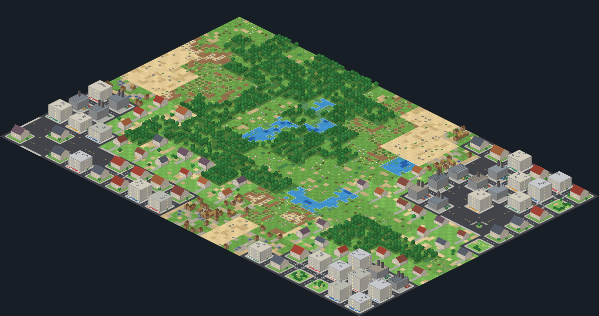
  <br><sub><code>hamc render --seed 23 --width 6 --height 4 --subgrid 3 --local 6 --style iso --tile-size 10</code></sub>
</p>

HAMC generates a map in three passes. A coarse grid of **regions** (forest,
desert, city) is collapsed first; every region is then split into **blocks**
(groves, rivers, oases, housing, shops, industry, roads, parks…) and every
block into **tiles**. Each pass is a Wave Function Collapse with constraint
propagation and backtracking, and each one is constrained by the pass above
it. The result is a tilemap with large-scale structure (a city is a city, not
a scatter of houses) and small-scale detail (doors, shop windows, reeds,
dunes) that a flat WFC on one grid struggles to produce.

The core is standard-library Python; [Pillow](https://python-pillow.org) is the
only dependency, used for the procedural renderer. A live dashboard streams
the collapse to the browser over Server-Sent Events.

## Gallery

| | |
|:---:|:---:|
| 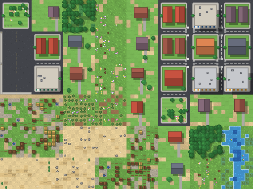 | 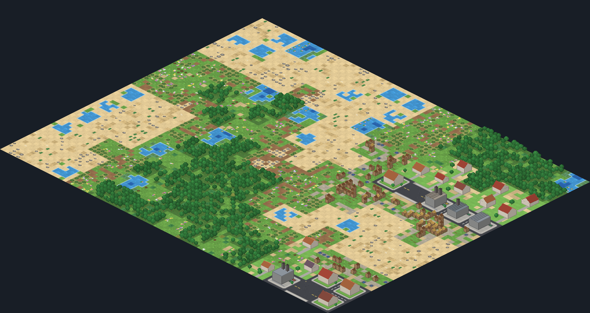 |
| `--seed 42 --width 4 --height 3 --subgrid 2 --local 8` · top-down | `--seed 4 --width 5 --height 4 --subgrid 3 --local 6` · iso |
| 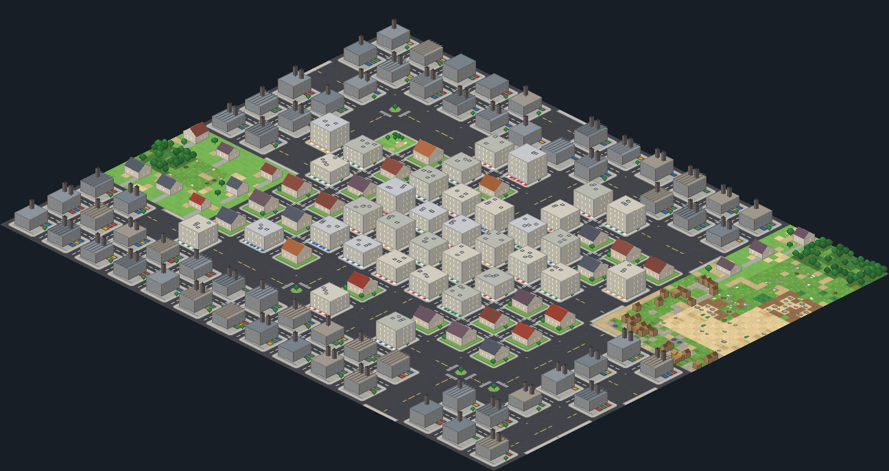 | 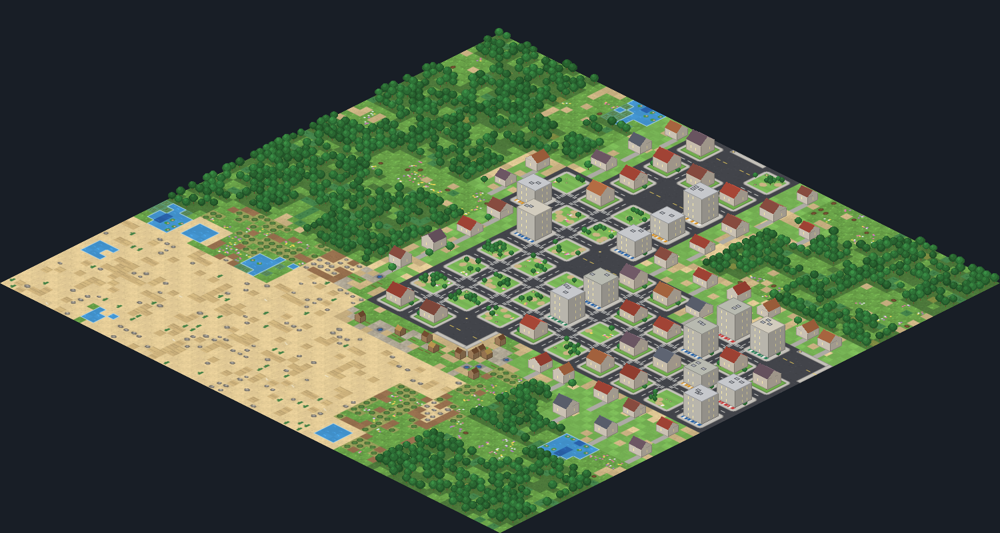 |
| forced districts ([example 4](examples/04_forced_districts.py)) | forced central park ([example 6](examples/06_central_park.py)) |
| 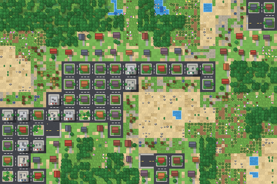 |  |
| `--seed 31 --width 6 --height 4 --subgrid 3 --local 5` · top-down | the collapse, layer by layer ([example 8](examples/08_animate.py)) |

All images are produced by `python docs/make_images.py` and the scripts in
[`examples/`](examples); the same seeds give the same pictures on any machine.

## Contents

- [How it works](#how-it-works)
- [Quickstart](#quickstart)
- [Examples](#examples)
- [Command line](#command-line)
- [Live dashboard](#live-dashboard)
- [Rendering](#rendering)
- [Performance](#performance)
- [Configuration](#configuration)
- [Architecture](#architecture)
- [Roadmap](#roadmap)
- [Contributing](#contributing)
- [License](#license)

## How it works

### Wave Function Collapse in one paragraph

Every cell of a grid starts with a set of possible values, each with a
weight. The solver repeatedly picks the open cell with the lowest Shannon
entropy (the least uncertain one), collapses it to a single value chosen by
weight, and **propagates**: each neighbour drops the values that are no longer
compatible with any value left in the cell, and those changes ripple outwards
(arc consistency). If some cell runs out of values, the solver **backtracks**:
it undoes the last decision, bans the value it chose and continues.

### Why three layers

A single WFC over a large tilemap only sees adjacent tiles, so it produces
texture, not geography: you get grass next to sand next to asphalt, but never
"a city to the east of a forest". HAMC runs the same algorithm at three
scales, and each layer becomes the *domain* of the next:

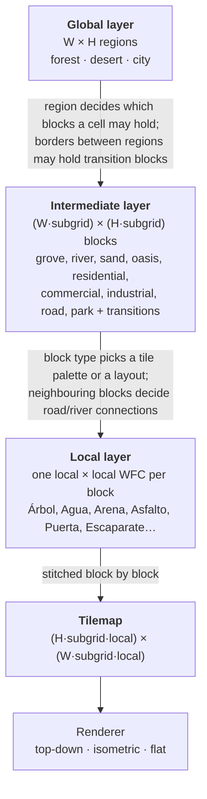

- **Global** (`GlobalGenerator`): every map must contain all three region
  types; if plain WFC keeps missing one, one cell per region is seeded and the
  rest collapses around it.
- **Intermediate** (`IntermediateGenerator`): a block cell may take the blocks
  of its own region. Cells on the edge of a region may also take the
  transition block towards the neighbouring region (`scrubland`, `periurban`,
  `village`). The block adjacency table then forces a transition wherever two
  regions really meet: `residential` cannot touch `sand`, so something
  compatible with both has to go between them.
- **Local** (`LocalGenerator`): plain blocks start from their weighted tile
  palette. Rivers and roads start from a channel laid towards the sides where
  the neighbouring block is also a river or road; oases from a central pond;
  buildings from a facade (roof row, walls, a door on the ground floor, shop
  windows for shops). WFC fills in the rest and a validator checks structure:
  every connected side of a road is reachable, a shop has at least two
  `Escaparate`, a factory a large metal/concrete section, and so on. A block
  that fails is regenerated (up to 25 attempts) so a map never ships with an
  invalid block.

### One step of the solver

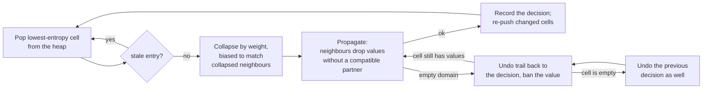

The open cells live in a heap keyed by `(entropy, not next to a collapsed
cell, random tie-break)`; changed cells are re-pushed and outdated entries are
skipped. Every change is written to an undo trail, so backtracking costs as
much as what it undoes, not the size of the grid (see
[Performance](#performance)).

All randomness comes from one `random.Random(seed)` per run, which is passed
down the three layers: a seed reproduces a map exactly, across processes and
with several runs in parallel.

## Quickstart

```bash
pip install "git+https://github.com/murapadev/HAMC"
# or, from a clone:
git clone https://github.com/murapadev/HAMC && cd HAMC && pip install -e ".[dev]"
```

Python 3.11+ is required. Your first map:

```python
from hamc import generate_map, render_map

hmap = generate_map(width=4, height=3, subgrid=2, local=6, seed=42)
render_map(hmap, style="topdown").save("quickstart.png")
```

Or from the shell: `hamc render --seed 42 -o map.png`.

`generate_map` returns a `HAMCMap` with the three layers as plain lists of
strings (`regions`, `blocks`, `tilemap`), the `seed` it used, `valid`,
`issues`, per-layer `timings` and the number of local `block_attempts`.

## Examples

Every snippet below is a script in [`examples/`](examples). They take an
optional output folder (default `output/examples`) and the outputs shown are
from real runs. CI runs all of them on every push.

```bash
cd examples
python 04_forced_districts.py /tmp/hamc
```

### Fixed seed and reproducibility — [`02_reproducible.py`](examples/02_reproducible.py)

```python
a = generate_map(4, 3, 2, 4, seed=1234)
b = generate_map(4, 3, 2, 4, seed=1234)
assert a.tilemap == b.tilemap

random_map = generate_map(4, 3, 2, 4)                          # no seed: one is drawn…
again = generate_map(4, 3, 2, 4, seed=random_map.seed)          # …and recorded
assert random_map.tilemap == again.tilemap
```

```text
seed 1234: e29680851a043e06
seed 1234: e29680851a043e06 (identical)
seed 1235: 7a703fa3d1e4d778
unseeded run used seed 2327105166; regenerated identically: True
```

The test suite also checks the same seed in two processes with different
`PYTHONHASHSEED` values and four seeds generated in parallel threads.

### A large map — [`03_large_map.py`](examples/03_large_map.py)

```python
hmap = generate_map(width=16, height=10, subgrid=4, local=6, seed=2024)
render_map(hmap, style="topdown", tile_size=4).save("large_map.png")
```

```text
384x240 = 92160 tiles, 64x40 blocks
timings: {'global': 0.0, 'intermediate': 0.09, 'local': 2.61} s
local attempts per block: 1.0
```

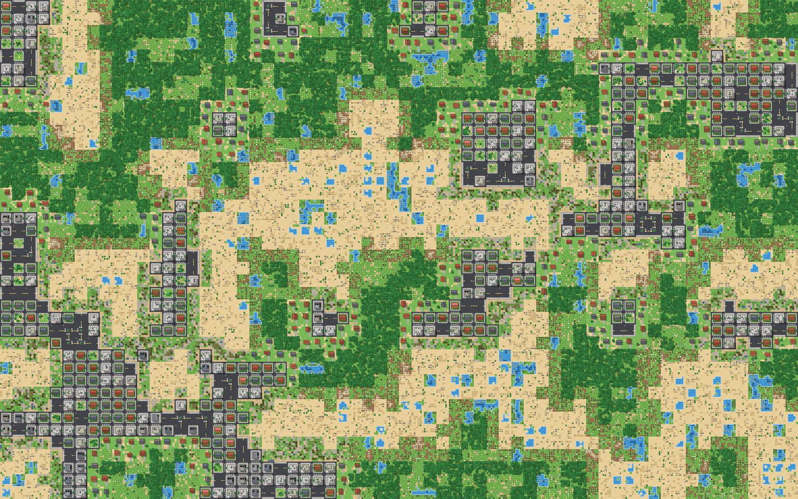

### Forced regions: downtown in the centre, industry on the outskirts — [`04_forced_districts.py`](examples/04_forced_districts.py)

Constraints are callables evaluated per cell. They return nothing (free),
a value to force, a set of allowed values or a `{value: weight}` dict:

```python
W, H, SUB = 5, 4, 3
rows, cols = H * SUB, W * SUB
cy, cx = (rows - 1) / 2, (cols - 1) / 2

def district(r, c, region):
    d = max(abs(r - cy) / cy, abs(c - cx) / cx)   # 0 at the centre, 1 at the edge
    if d < 0.3:
        return {"commercial": 0.85, "road": 0.15}
    if d > 0.75:
        return {"industrial": 0.7, "road": 0.15, "park": 0.15}
    return {"residential": 0.6, "park": 0.15, "road": 0.15, "commercial": 0.1}

hmap = generate_map(W, H, SUB, 6, seed=7,
                    region_weights={"city": 1.0},
                    constrain_regions=lambda r, c: "city" if 0 < r < H - 1 and 0 < c < W - 1 else None,
                    constrain_blocks=lambda r, c, region: district(r, c, region) if region == "city" else None)
```

```text
ind ind ind ind ind roa ind ind ind ind ind ind per gro gro
ind ind ind ind ind ind ind ind roa ind ind ind per cle cle
roa ind roa roa roa com com roa com com roa roa per cle scr
ind ind roa par res com res roa com res res res vil scr san
ind ind com com res com com com com com res com vil san san
ind ind roa com res com com com com com com roa vil vil vil
per per per res res com com com com com res res roa ind ind
gro cle per res res com com com com com res res roa ind roa
per per per res com res roa res roa res res res roa ind ind
ind ind roa com roa roa roa com roa com roa roa roa ind roa
ind ind ind ind ind ind ind ind ind ind ind roa ind ind roa
ind ind ind ind ind ind ind ind ind ind ind roa ind ind ind
```


A constraint that the layer above makes impossible (a park in a forest region)
raises `ValueError` naming the cell and what it could hold instead.

### Custom tile weights — [`05_custom_weights.py`](examples/05_custom_weights.py)

```python
hmap = generate_map(
    6, 4, 3, 6, seed=99,
    region_weights={"forest": 0.7, "desert": 0.1, "city": 0.2},
    block_weights={"forest": {"grove": 0.9, "clearing": 0.1, "river": 0.0}},   # 0 removes a block
    tile_weights={"grove": {"Árbol": 0.85, "Hierba": 0.05}},
)
```

```text
top tiles: Árbol 67%, Hierba 7%, Musgo 5%, Helecho 3%, Arena 2%
```

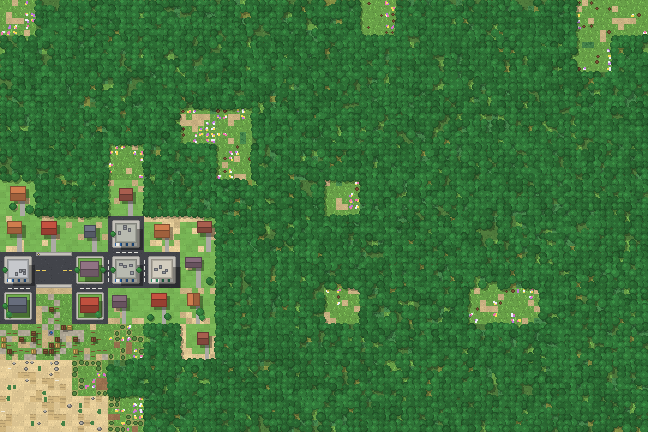

Overrides are merged into the defaults; unknown names raise `ValueError`.
Blocks built from a layout (rivers, roads, oases, buildings) set most cells
explicitly, so tile weights matter most for the palette blocks (grove,
clearing, sand, scrubland, periurban, village, park).

### Custom constraint: a central park — [`06_central_park.py`](examples/06_central_park.py)

```python
W, H, SUB = 3, 3, 5
centre = (H * SUB) // 2, (W * SUB) // 2

hmap = generate_map(
    W, H, SUB, 5, seed=5,
    constrain_regions=lambda r, c: "city" if (r, c) == (1, 1) else None,
    constrain_blocks=lambda r, c, region: (
        "park" if abs(r - centre[0]) <= 1 and abs(c - centre[1]) <= 1 else None),
)
```

```text
blocks of the central city region:
periurban   commercial  park        road        residential
periurban   park        park        park        commercial
periurban   park        park        park        commercial
periurban   park        park        park        residential
village     residential residential road        village
```

The park is 3×3 blocks inside a 5×5 city region: the outer ring needs room for
the transition blocks towards the neighbouring regions (a park can't touch a
village or the desert directly).

### Export to JSON and images — [`07_export.py`](examples/07_export.py)

```python
hmap = generate_map(4, 3, 2, 6, seed=42)
hmap.save_json("map.json")                      # or hmap.to_dict()
for style in ("flat", "topdown", "iso"):
    render_map(hmap, style=style, tile_size=10).save(f"map_{style}.png")
```

```text
JSON keys: width, height, subgrid, local, seed, regions, blocks, tilemap, valid, issues, timings, block_attempts
tilemap[0][:6] = ['Cesped_urbano', 'Flores', 'Cesped_urbano', 'Cesped_urbano', 'Farola', 'Cesped_urbano']
flat     480x360px -> output/examples/map_flat.png
topdown  480x360px -> output/examples/map_topdown.png
iso      840x470px -> output/examples/map_iso.png
```

### Observer hook: animate the collapse — [`08_animate.py`](examples/08_animate.py)

`generate_map(observer=...)` calls your function with every event of the
three layers (`start`, `init`, `collapse`, `conflict`, `backtrack`,
`complete`, `fail`, plus `local_block_start` / `local_block_complete`). Each
event carries its `level`; collapses carry `pos`, `value`, `entropy` and the
neighbours changed by propagation. The example keeps a copy of each layer,
snapshots it into frames and ends on the painted map:

```python
def observer(event):
    if event["type"] == "collapse" and event["level"] == "global":
        regions[event["pos"][0]][event["pos"][1]] = event["value"]
        snapshot()
    ...

hmap = generate_map(4, 3, 3, 6, seed=23, observer=observer)
frames[0].save("collapse.gif", save_all=True, append_images=frames[1:], duration=60, loop=0)
```

```text
83 frames, 106 KiB -> output/examples/collapse.gif
```


### A batch of maps with statistics — [`09_batch_stats.py`](examples/09_batch_stats.py)

```text
20 maps of 6x4 regions / 18x12 blocks / 108x72 tiles
valid: 20/20
time per map: median 0.24s, max 0.24s
local attempts per block: mean 1.000
regions: forest 50%, city 26%, desert 25%
blocks:  grove 24%, sand 16%, periurban 13%, scrubland 11%, clearing 11%, village 8%, residential 5%, river 4%
```

## Command line

`pip install` provides a `hamc` command (also `python -m hamc`):

| Command | What it does |
|---|---|
| `hamc generate [grid options] [-o DIR] [--json]` | writes `global_map.png`, `intermediate_map.png`, `final_tilemap.png` (with layer grid), `final_tilemap_clean.png` and `map.json` to `DIR` (default `output/`); `--json` prints the map to stdout instead |
| `hamc render [grid options] [--size WxH] [--style topdown\|iso\|flat] [--tile-size PX] [-o FILE] [--json PATH]` | paints the map; `--size` is a target in tiles (it sets `--width/--height` from `--subgrid`/`--local`) |
| `hamc dashboard [--host H] [--port P] [--open]` | serves the live dashboard |

Grid options: `--width` and `--height` (regions, default 4×3), `--subgrid`
(blocks per region side, default 2), `--local` (tiles per block side, default
4, or 8 for `render`), `--seed`, `--debug`.

```console
$ hamc render --seed 42 --size 64x64 --style iso -o mapa.png
seed 42: 64x64 tiles, iso 1536x828px -> mapa.png
$ hamc generate --width 1 --height 2
hamc: error: a 1x2 region grid has 2 cell(s), but every map needs all 3 region types (forest, desert, city); use at least 3 cells, e.g. width=3 height=1
```

Grids too small for all three regions, or blocks smaller than 3×3 (no room
for a building), are rejected with exit status 1.

## Live dashboard

```bash
hamc dashboard --open        # http://127.0.0.1:8765
```

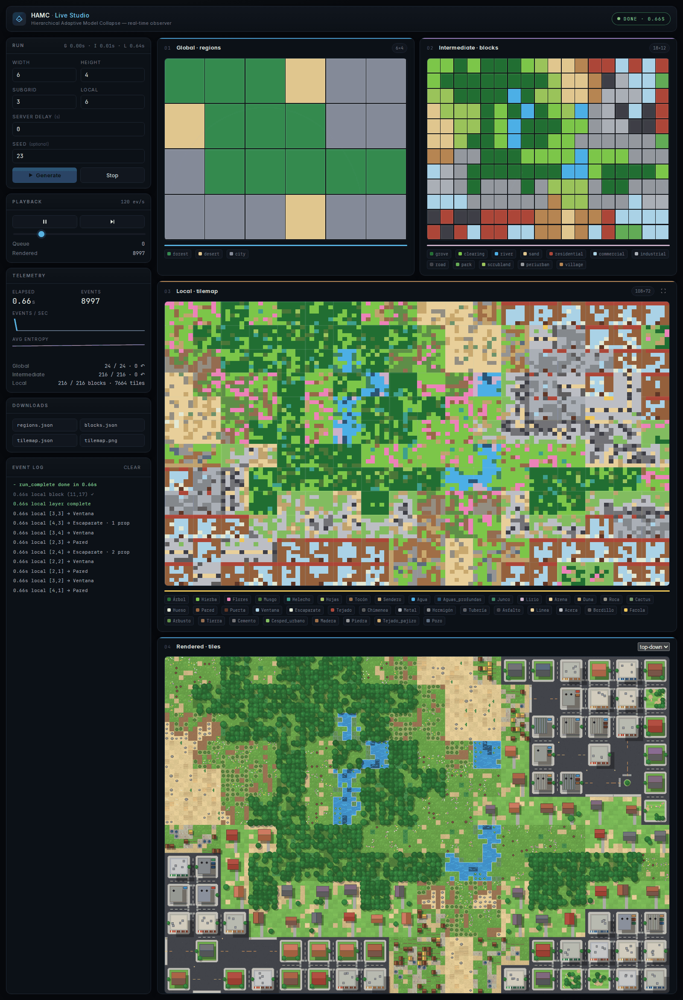

The dashboard is a standard-library HTTP server. `GET /api/stream` runs a
generation and streams its observer events over Server-Sent Events; the
browser replays them on three canvases (regions, blocks, tiles) with playback
speed, pause and single-step controls, an event log and telemetry. When the
run finishes, the fourth panel shows the map painted by the renderer
(`GET /api/render` regenerates the run's seed, which is deterministic) in
top-down or isometric view.

It is meant for local use: CORS is only echoed for loopback origins, at most 3
generations run at once, a request may produce at most 128×128 tiles and
parameters are clamped (`width`/`height` 1–8, `subgrid` 1–4, `local` 3–8).
Binding to a non-loopback `--host` logs a warning.

## Rendering

`render_map(hmap, style="topdown" | "iso" | "flat", tile_size=12)` returns a
Pillow image. Everything is drawn with Pillow primitives and seeded noise:
there are no image assets in the repository.

- **Natural blocks** are painted tile by tile: grass and forest floor with
  speckle and tufts, sand and dunes, water with ripples and foam where it
  meets land, trees, palms, rocks, cacti, reeds, lily pads, bushes, huts,
  fences and wells.
- **City blocks** become lots. Each residential, commercial, industrial or
  park block gets a street frontage and a sidewalk, so adjacent lots form a
  street grid with dashed centre lines and zebra crossings at intersections.
  Houses get gable roofs (with a chimney if the block's tiles have one),
  shops flat roofs with AC units and one awning per shop window tile,
  factories sawtooth or flat metal roofs, smokestacks, pipes and containers;
  parks put trees, paths and flowers where their tiles are.
- **Roads** are autotiled from their connections: lane markings run to every
  side that touches another road, crossings get a small roundabout with
  crosswalks, and sides that open onto nothing get a sidewalk.
- **Periurban** blocks are drawn as suburban plots (lawn, a house, a
  driveway, trees).
- **Isometric** view: the ground is the top-down ground warped by a 2:1
  affine transform; buildings (extruded walls with windows, gable or flat
  roofs, chimneys) and trees are drawn on top in back-to-front order.
- **Flat** view: one colour per tile, as in the dashboard.

Rendering is deterministic for a given map and takes well under a second for
the maps in this README.

## Performance

Measured with [`benchmarks/bench.py`](benchmarks/bench.py) (median of 3
seeds) on an Intel Core i7-5930K (6 cores, 4.0 GHz overclock, single-threaded
run), 62 GiB RAM, Linux, Python 3.14.8. "Before" is the solver right before
the heap/undo-trail change (commit `ae60828`), which rescanned the grid for
every choice and copied it for every backtrack point.

| Case | Cells | Before | Now |
|---|---:|---:|---:|
| single layer 16×16 | 256 | 0.082 s | 0.008 s |
| single layer 32×32 | 1,024 | 1.691 s | 0.031 s |
| single layer 48×48 | 2,304 | 8.716 s | 0.073 s |
| single layer 64×64 | 4,096 | 27.790 s | 0.130 s |
| full map 4×3, subgrid 2, local 4 | 828 | 0.037 s | 0.026 s |
| full map 8×6, subgrid 3, local 6 | 16,032 | 1.031 s | 0.471 s |
| full map 8×8, subgrid 4, local 4 | 17,472 | 2.185 s | 0.516 s |
| full map 16×12, subgrid 4, local 6 | 113,856 | 20.732 s | 3.325 s |

"Single layer" is one N×N WFC (the grove palette), where the old quadratic
behaviour shows; a full map is many small local grids, so it gains less. The
cells column counts all three layers. Rendering adds about 0.06 s (top-down) / 0.08 s
(iso) for a 64×64-tile map and 0.15 s for the hero image.

```bash
pip install -e . && python benchmarks/bench.py   # --quick skips the largest cases
```

## Configuration

The vocabulary lives in plain Python tables under `hamc/config/`:

| File | Contents |
|---|---|
| `region_config.py` | regions, their weights and which regions may touch |
| `block_config.py` | blocks per region with weights, transition blocks between regions, block adjacency |
| `tile_config.py` | tile palette per block, tile adjacency, flat colours |
| `advanced_config.py` | a few probabilities used by the oasis layout and validator |
| `weights.py` | merges user overrides into the tables (`generate_map(*_weights=...)`) |

Adjacency tables are written one-way for readability and made symmetric at
import time. For one-off changes prefer the `region_weights`,
`block_weights`, `tile_weights`, `constrain_regions` and `constrain_blocks`
arguments of `generate_map` over editing the tables.

## Architecture

```text
hamc/
├── __init__.py            generate_map, render_map, HAMCMap, errors, __version__
├── pipeline.py            generate_map(): runs the three layers, retries, validity, observer tagging
├── cli.py                 `hamc generate | render | dashboard`
├── dashboard.py           stdlib HTTP server: SSE stream, /api/render, limits
├── dashboard_static/      dashboard front end (HTML/CSS/JS, no build step)
├── generators/
│   ├── base_generator.py  the WFC solver: entropy heap, AC propagation, undo trail, observer events
│   ├── global_generator.py        regions; guarantees every region type
│   ├── intermediate_generator.py  blocks; transition blocks on region borders
│   └── local_generator.py         tiles; layouts for rivers, roads, oases, buildings; retries
├── core/
│   ├── cell.py            a cell's weighted domain and collapse
│   ├── entropy.py         Shannon entropy, weighted choice from an injected RNG
│   ├── validator.py       river/road connectivity, oasis and building rules
│   └── generator_state.py status and counters per generator
├── config/                the tables above
└── visualization/
    ├── painter.py         procedural renderer (top-down, iso, flat)
    └── renderer.py        flat-colour layer images used by `hamc generate`
```

Tests live in `tests/` (pytest), runnable scripts in `examples/`, the
benchmark in `benchmarks/`, and `docs/make_images.py` rebuilds the README
images. `docs/AUDITORIA.md` (Spanish) is the code audit that preceded the
2026 simplification; see [CHANGELOG.md](CHANGELOG.md).

## Roadmap

Known limitations and likely next steps, roughly by value:

- **Seams between blocks.** Each block is generated on its own; tiles only
  see the neighbouring block's *palette*, not its actual edge tiles, so
  forest and sand meet in straight lines. Generating blocks with their
  neighbours' edges as constraints (overlapping WFC) would fix it.
- **Rivers as networks.** River blocks connect to adjacent river blocks, but
  nothing makes a river flow from one map edge to another; they often form
  ponds.
- **Local facades vs. top-down art.** Building blocks are generated as street
  facades (roof row, windows, door), while the renderer draws them top-down
  and only uses those tiles for details (chimneys, shop windows, pipes).
- **Parallel local layer.** Blocks are independent once the intermediate layer
  is done; with one seeded RNG per block they could be generated in parallel
  while staying reproducible.
- **Tables as data.** Moving regions, blocks and tiles to a TOML/JSON file
  would allow new biomes without touching code.
- **Packaging.** Not on PyPI yet; install from git.

## Contributing

Issues and pull requests are welcome.

```bash
git clone https://github.com/murapadev/HAMC && cd HAMC
python -m venv .venv && . .venv/bin/activate
pip install -e ".[dev]"
pytest              # tests
ruff check .        # lint (config in pyproject.toml)
```

CI runs ruff, pytest on Python 3.11–3.13, a CLI smoke test and every script in
`examples/`. Please add a test for behaviour changes, keep the examples
running, and use semantic commit messages (`feat:`, `fix:`, `perf:`…). If a
change alters generated maps, regenerate the README images with
`python docs/make_images.py`.

## License

[MIT](LICENSE) © Pablo RM (@murapadev). The renderer draws everything
procedurally; the repository contains no third-party art.
